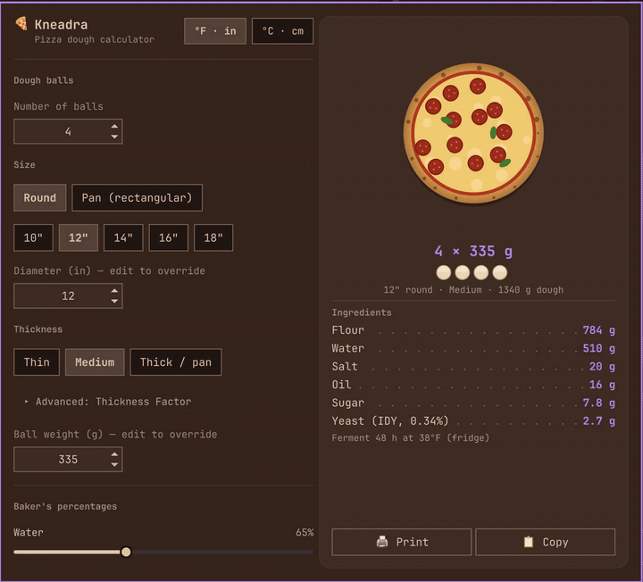
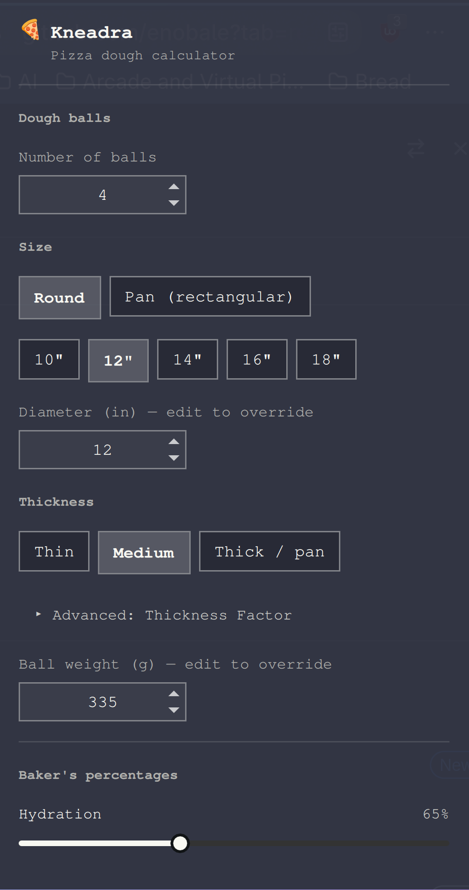

# Kneadra



**Plan pizza dough right from your Omarchy bar.** Tell Kneadra how many
pizzas, what size and crust, and how long the dough will ferment, and it
gives you the exact grams of flour, water, salt, oil, and yeast on a live
recipe card.

- 🍕 **See what you're making.** The card draws your pizza to scale: it grows
  with the diameter, turns into a pan pie in pan mode, and its crust puffs
  up from thin to thick.
- ⏱️ **Yeast that matches your schedule.** Same-day, overnight on the
  counter, or 2–3 days in the fridge: the yeast amount comes from a real
  fermentation chart (35–80°F), not a one-size rule of thumb, so long
  room-temperature ferments don't come out overproofed.
- 🧊 **Two-stage ferments.** An hour on the counter, then 72 h in the
  fridge (or the other way round) gets one yeast amount for the whole plan.
- 🫙 **Poolish.** Ferment part of the flour ahead with the same weight of
  water; the card splits into a poolish and a final dough.
- 🦠 **Sourdough.** Add a starter (by % of the flour and its hydration) in
  place of commercial yeast, on its own or alongside a poolish.
- 🌾 **Flour blends.** Up to four named flours (00 with some bread flour,
  say), each weighed out on the card.
- 📅 **Plan by bake time.** Say when the pizza goes in the oven and Kneadra
  works back to when to mix, when to take the dough out of the fridge, and
  when to preheat, and can set an Omarchy reminder for each step.
- 🥄 **Grams and teaspoons.** Yeast shows the exact grams plus the nearest
  measuring-spoon amount (≈ 3/8 tsp), for when the scale isn't handy.
- 🎚️ **Change anything, see the grams change.** Settings on the left, recipe
  on the right, updating as you drag.
- 🖨️ **Take it to the kitchen.** Print it (or save as PDF), or copy it as
  text.
- 🌍 **°F and inches, or °C and centimetres.** One click in the header
  switches every size, temperature, and label.
- 💾 **Remembers your recipe.** Your settings are still there after a
  restart or reboot.
- Round pies or rectangular pans (Detroit, Sicilian, grandma), any ball
  count, and instant, active dry, or fresh yeast.

Click the 🍕 icon in the bar to open it.

## How it works




Set the number of dough balls and choose round (with a diameter override)
or a rectangular pan (width × length), plus a crust Thickness Factor —
Thin/Medium/Thick presets, or an advanced raw oz/in² override for anyone
who already knows their number — to get a suggested per-ball dough weight
(always editable by hand). Baker's percentages — water (hydration), salt, oil,
sugar, and optional diastatic malt (0% by default; for extra browning in a
home oven) — are set with sliders. Pick a fermentation temperature (°F) and
target time, and the yeast percentage is read from a fermentation chart
(hours to full proof by temperature and yeast dose, 35–80°F) and
interpolated between its cells; shorter or warmer ferments need more yeast,
long ferments — including 24h+ at room temperature — need very little. If
the time or temperature falls outside what the chart covers, a note under
the yeast row says so. Yeast type (instant dry / active dry / fresh)
converts the final gram amount; dry yeast also shows a teaspoon measure
(about 3.1 g per teaspoon — a 7 g packet is 2¼ tsp).

Choose **Two stages** for a two-stage ferment. Each stage gets its own
temperature and time, and the yeast is the dose at which the stages together
add up to one full proof (each stage contributes its hours ÷ the chart's
hours-to-full-proof at that temperature). One practical exception: next to
a fridge stage, the first 3 h of each room-temperature (60°F+) stage don't
count, so a bench rest or warm-up doesn't cut the cold-ferment yeast. Chart
doses for cold ferments already run low in practice, as bakers on the Pizza
Making Forum report; this is a rule of thumb, not chart data.

Turn on **Poolish** to ferment part of the flour (10% up to the dough's
hydration) ahead of time, at room temperature (60–80°F), with an equal
weight of water. Its yeast comes from the same chart, for the poolish's own
time and temperature — about 0.04% instant yeast for 16 h at 70°F, in line
with published poolish guidelines. (There's no fridge option: there's no
reliable data for a cold poolish, and the dough chart overshoots badly
there); the main
fermentation's yeast is then measured against the flour added at the final
mix. The card lists the poolish and the final dough separately, and the
schedule adds a "Mix poolish" step.

Turn on **Sourdough starter** to add a starter at its peak to the final
dough. Set how much (starter weight as a % of all the flour; 20% is a common
starting point) and its hydration; its flour and water count toward the
dough's totals, and the main dough then gets no commercial yeast. A poolish
can be used at the same time and keeps its own pinch of yeast. Kneadra
doesn't time a sourdough for you — how fast it rises depends on the
starter — so the ferment times you set only drive the schedule.

Under **Flour**, name your flour and add up to three more; the first one
takes whatever percentage the others leave.

Turn on **Plan by bake time** and choose how to plan:

- **Bake at a time** — pick a bake day and time (you can type too: "sat",
  "6:30 pm", "18:30") and the card works back to when to mix, when to move
  the dough between stages, and when to preheat (an hour ahead). A time too
  soon for the ferment moves to the earliest bake that works.
- **Start now** — the dough is mixed now; the bake follows the ferment, so
  changing a stage's hours moves the bake time. **Mixed just now** resets
  the mix time.

**Remind** sets a desktop reminder for each upcoming step through
`omarchy-reminder`. Those reminders are systemd user timers, so a reboot or
logout clears them.

The recipe card shows the resulting flour, water, salt, oil, sugar,
diastatic malt (when used), and yeast weights in grams for the total batch.

Settings are saved to `~/.local/state/omarchy/io.github.enobale.kneadra.json`
(delete it to start over from the defaults).

## Install

```bash
omarchy plugin add https://github.com/enobale/omarchy-kneadra --enable
```

Or, to keep a local editable copy instead of a git checkout:

```bash
git clone https://github.com/enobale/omarchy-kneadra ~/.config/omarchy/plugins/io.github.enobale.kneadra
omarchy plugin enable io.github.enobale.kneadra
```

## Keybinding

Kneadra exposes an IPC target, so you can open it from the keyboard. Add to
`~/.config/hypr/bindings.conf`:

```
bind = SUPER ALT, P, exec, qs -p /usr/share/omarchy/shell ipc call io.github.enobale.kneadra toggle
```

## Remove

```bash
omarchy plugin remove io.github.enobale.kneadra
```

## Files

- `manifest.json` — plugin manifest (`kinds: ["bar-widget"]`)
- `BarWidget.qml` — bar icon + popup UI, built on Omarchy's `Panel` /
  `KeyboardPanel` / `WidgetButton` / `PanelSlider` / `NumberField` /
  `ButtonGroup` / `Toggle` components (no external dependencies beyond
  the Omarchy shell's own `qs.Ui` / `qs.Commons` component kit)
- `PizzaPreview.qml` — the to-scale pizza + dough-ball illustration on the
  recipe card (a QML `Canvas`)
- `Calculator.js` — pure dough-math helpers (dough-weight suggestion from
  pan area and Thickness Factor, temperature/time-based yeast percent,
  baker's-percentage solve, two-stage fermentation, teaspoon conversion,
  bake schedule)

## License

MIT — see [LICENSE](LICENSE).
